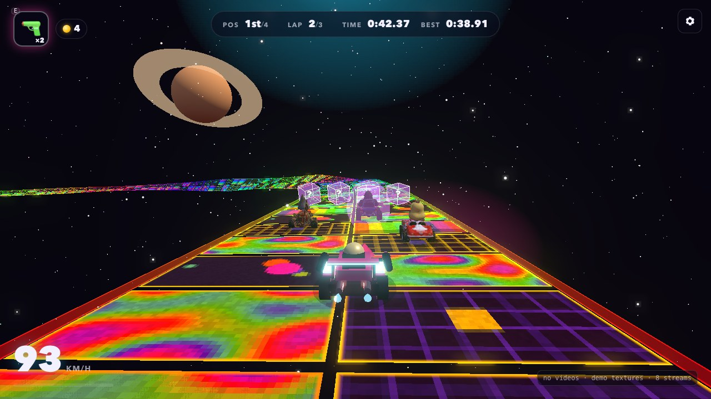
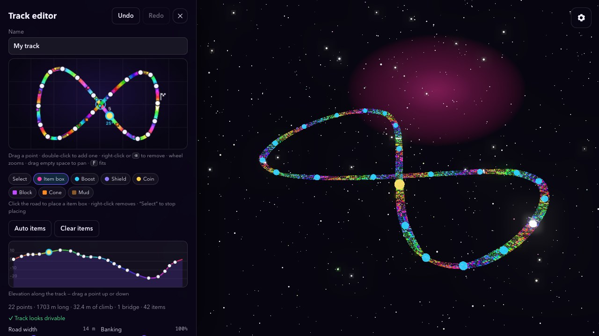

# Rainbow Video Road

A 3D kart racer in the spirit of *Rainbow Road*, where the road itself is made of
video. Point the game at a folder of clips and every slat of the floating track becomes
a live, pixelated, hue‑shifted segment of one of your videos — a rainbow you drive on.



**Play it:** https://vectorless.github.io/rainbow-video-road/ (works on phones too: drag on the
left to steer, buttons on the right)

- Procedurally generated looping track in space (seeded; some layouts bridge over themselves)
- Built‑in **track editor**: drag points on a top‑down map and an elevation strip while the
  3D track rebuilds live; save, export, import and share tracks as links
- Each slat tile streams a clip from your folder, pixelated and recoloured in a shader
- Arcade driving: acceleration, drifting with mini‑turbos, banked corners
- Three AI rivals (a princess, a gorilla and a mushroom charioteer) with a starting grid,
  bumping and a race position in the HUD
- Pickups: boost orbs, shields, coins (a little extra top speed each) and **?** item boxes
  that give a held item — boost, shield, a 3‑shot **laser** that bolts onto your kart, or a
  cone / mud patch to drop behind you
- Obstacles: blocks (ricochet, spin, stop), cones (knocked flying off the road) and mud
  (slows you down)
- No barriers by default: drive off the edge and a **space god** swoops down, beams you up
  and puts you back on the road (guard rails are still an option in Settings)
- Chase / far / hood cameras, lap timing, bloom, gamepad support
- Clips are read directly by your browser — nothing is uploaded anywhere

## Run it

```bash
npm install
npm run dev
```

Open the printed URL (default `http://localhost:5173`), click **Choose video folder**
and pick a folder that contains video files. You can also drop a folder onto the page.

Build a static version with `npm run build` (output in `dist/`, serves from any static host).

Every push to `main` is built and deployed to GitHub Pages by `.github/workflows/pages.yml`:
**https://vectorless.github.io/rainbow-video-road/**

## Controls

| Action | Keyboard | Gamepad | Touch |
| --- | --- | --- | --- |
| Accelerate / brake‑reverse | `W` `S` or `↑` `↓` | RT / LT | automatic gas · hold **Brake** |
| Steer | `A` `D` or `←` `→` | Left stick | drag left / right on the left half |
| Drift (release for a mini‑turbo) | `Shift` or `Space` | A | hold **Drift** |
| Use held item | `E` | LB / RB | **Item** |
| Reset to the road | `R` | Y | — |
| Change camera | `C` | X | **Cam** |
| Pause | `Esc` or `P` | Start | **❚❚** |

## Track editor



Open it from the main menu (or the pause menu). The left panel shows the track from above
and its elevation profile; the 3D view behind it rebuilds as you edit.

- **Drag** a point to move it · **double‑click** empty space to add a point to the nearest
  segment · **right‑click** (or `⌫`) to remove one · wheel zooms, drag empty space to pan,
  `F` fits the view
- Drag a point **up or down in the elevation strip** to change its height
- **Road width** and **Banking** sliders apply to the whole track; select a point and tick
  **Bank at point … by hand** to set its banking angle yourself (the road eases between
  points, so a run of hand-set points makes a banked section)
- **Items**: pick a tool under the map (item box, boost, shield, coin, block, cone, mud) and
  click the road to place it; drag items to move them, right‑click or `⌫` to remove.
  **Auto items** scatters a generated set, **Clear items** removes them all
- **Set start here** makes the selected point the start/finish line
- Warnings flag corners too tight for the road width, very steep slopes, and places where
  the track crosses itself without enough vertical clearance (crossings with room are
  drawn as bridges)
- **Test drive** races from the selected point; `Esc` pauses and the pause menu takes you back
- **Save** keeps tracks in the browser ("Load a saved track…" lists them), **Export / Import**
  move them as `.json` files, and **Copy share link** puts the whole track in the page URL
- `⌘Z` / `Ctrl+Z` undo, `⇧⌘Z` / `Ctrl+Y` redo. Drag the 3D view to orbit, wheel to zoom.

The game remembers the last track you used. Changing the **Track seed** in Settings goes
back to a generated layout.
